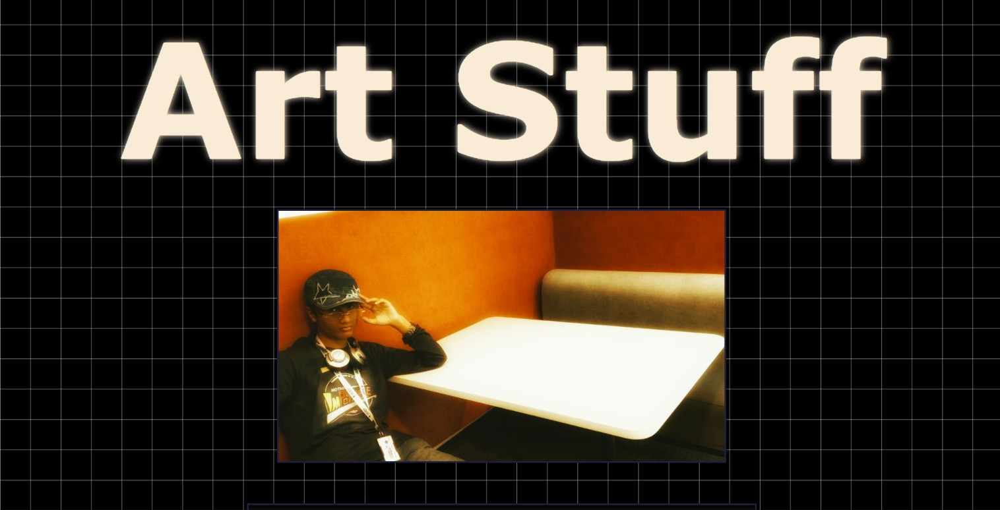
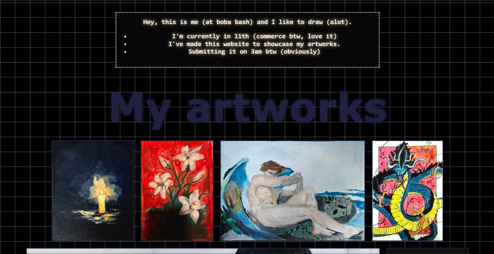

# Art Stuff
**coded by: Mukul**

I have coded this personal website to showcase the different mediums of art i indulge myself in "-" 

# My demo link
[https://mukul-mittal-art.github.io/ArtStuff/](https://mukul-mittal-art.github.io/ArtStuff/)

# Tech stack
Program used: Visual Studio Code
Languages used: CSS and HTML

# What does it do?
makes me happy. (jk)
It's a project that showcases

# How did i make it?
* I made a rough sketch on paper on how i want it to look
* I imported all necessary files and pictures
* Then, i began with index.html (home page).
* I added my main texts and images and hover effects.
* Then, i added my artworks, made some changes to the css.
* I finalised the project with some more aesthetic changes positioning.

# Problems i faced
* How to make my text glow?
* How to position my stuff properly.
* How to do make grid on background.
These were some of the major problems i faced, among countless minor ones that increased this project's worktime ;-;

# AI USAGE
None at all.

# Screenshots


 
        
# How to run the project locally                                                                                        
Clone and run this repository:
```bash
git clone [https://github.com/mukul-mittal-art/Mukulandmaachis.git](https://github.com/mukul-mittal-art/Mukulandmaachis.git)